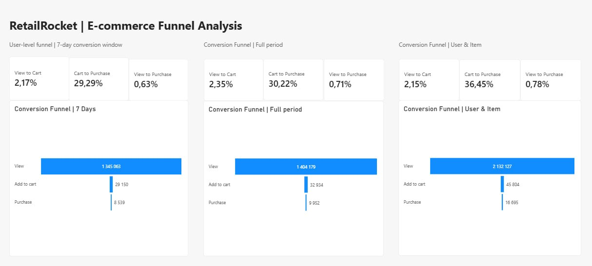

# Анализ поведения пользователей интернет-магазина RetailRocket

Портфолио-проект по продуктовой аналитике: очистка данных, SQL-запросы, исследовательский анализ, воронка, анализ товаров и категорий, когорты и дашборд Power BI. Отдельный ноутбук посвящён статистическому анализу рандомизированного эксперимента с email-рассылкой.

## Цель проекта

Описать взаимодействия пользователей с товарами и найти направления для дальнейшего исследования. В проекте рассматриваются активность аудитории, последовательность «просмотр → корзина → покупка», концентрация событий среди пользователей и товаров, категории и недельные возвраты.

## Данные

Основной источник — [датасет RetailRocket на Kaggle](https://www.kaggle.com/datasets/retailrocket/ecommerce-dataset):

| Файл | Содержание |
|---|---|
| `events.csv` | События `view`, `addtocart`, `transaction` с идентификаторами пользователя и товара. |
| `item_properties_part1.csv`, `item_properties_part2.csv` | История свойств товаров, включая категорию. |
| `category_tree.csv` | Иерархия категорий без человекочитаемых названий. |

После удаления 460 полных дубликатов осталось **2 755 641 событие** от **1 407 580 пользователей** за период **3 мая — 18 сентября 2015 года**. Часовой пояс исходных временных меток не установлен.

Для [статистического ноутбука](notebooks/05_statistical_analysis.ipynb) используется **отдельный датасет** — [Hillstrom E-Mail Analytics Challenge](https://blog.minethatdata.com/2008/03/minethatdata-e-mail-analytics-and-data.html). Его 64 000 клиентов были случайно распределены между двумя вариантами письма и контрольной группой; результаты отслеживались две недели. Здесь сравниваются группы `Womens E-Mail` и `No E-Mail`. Результаты эксперимента не относятся к пользователям RetailRocket.

CSV-файлы не хранятся в репозитории. Инструкция по их размещению приведена ниже.

## Основные результаты RetailRocket

- **Активность:** `view` составляет **96,68%** событий. **71,16%** пользователей совершили только одно зарегистрированное событие; на 10% самых активных приходится **42,25%** всех событий. Это описательные показатели, а не конверсия.
- **Воронка за 7 суток:** среди **1 345 063** пользователей с первым просмотром и полным окном наблюдения **2,17%** достигли корзины и **0,63%** прошли все три этапа до покупки. Этапы одного пользователя могут относиться к разным товарам. Другие определения воронки и расчёты — в [методологии](docs/funnel_analysis.md).
- **Товары:** на топ-1% наблюдаемых товаров приходится **22,71%** просмотров и **48,19%** событий `transaction`. Для двух типов событий топ рассчитан отдельно.
- **Категории:** категорию на момент события удалось определить для **76,16%** событий.
- **Возвраты:** недельная когорта задаётся первым *наблюдаемым* событием пользователя. В рассмотренных когортах доля пользователей с любым событием в следующую неделю составляла примерно **2,6–4,8%**; поздние когорты наблюдались не полностью.

Эти результаты описывают наблюдаемое поведение. Они позволяют предложить гипотезы для проверки, но не доказывают причины поведения или эффект продуктовых изменений.

## Отдельный статистический эксперимент

В данных Hillstrom основная метрика `visit` составила **15,14%** в группе `Womens E-Mail` и **10,62%** в группе `No E-Mail`: разница **4,52 процентного пункта** (приближённый 95% доверительный интервал **3,89–5,16 п. п.**). По дополнительной метрике `conversion` доли составили **0,88%** и **0,57%**: разница **0,31 п. п.** (приближённый 95% интервал **0,15–0,47 п. п.**). В ноутбуке приведены двусторонние z-тесты; поправка на проверку нескольких метрик не применялась.

## Структура проекта

| Путь | Содержание |
|---|---|
| [`notebooks/01_data_cleaning.ipynb`](notebooks/01_data_cleaning.ipynb) | Очистка CSV и подготовка файлов в `data/processed/`. |
| [`notebooks/02_eda.ipynb`](notebooks/02_eda.ipynb) | Типы событий и временная динамика. |
| [`notebooks/03_product_analysis.ipynb`](notebooks/03_product_analysis.ipynb) | Активность товаров, концентрация и категории. |
| [`notebooks/04_customer_analysis.ipynb`](notebooks/04_customer_analysis.ipynb) | Активность пользователей, сегменты и недельные когорты. |
| [`notebooks/05_statistical_analysis.ipynb`](notebooks/05_statistical_analysis.ipynb) | Эксперимент Hillstrom: доли посещений и конверсий. |
| [`sql/`](sql/) | SQL: обзор → пользователи → воронка → товары → категории → когорты. |
| [`docs/funnel_analysis.md`](docs/funnel_analysis.md) | Определения и результаты трёх вариантов воронки. |
| [`dashboards/retailrocket_dashboard.pbix`](dashboards/retailrocket_dashboard.pbix) | Дашборд Power BI; [изображение воронки](dashboards/retailrocket_funnel_dashboard.png). |



## Как воспроизвести анализ

### 1. Установка

Проект выполнялся с Python 3.14. Из корня репозитория:

```bash
python3.14 -m venv .venv
source .venv/bin/activate
python -m pip install -r requirements.txt
```

Команды активации приведены для macOS/Linux. В VS Code выберите `.venv` как ядро ноутбуков.

### 2. Подготовка CSV

Создайте локальные папки, если их нет после клонирования:

```bash
mkdir -p data/raw data/processed
```

Скачайте RetailRocket с Kaggle и поместите в `data/raw/` файлы `events.csv`, `item_properties_part1.csv`, `item_properties_part2.csv`, `category_tree.csv`. CSV со страницы Hillstrom сохраните как `data/raw/hillstrom_email.csv`.

Запустите [`01_data_cleaning.ipynb`](notebooks/01_data_cleaning.ipynb) из папки `notebooks/`. Он создаёт `data/processed/events_clean.csv`, `items_properties_clean.csv`, `item_category_history_clean.csv` и `category_tree_clean.csv`. Затем можно выполнять ноутбуки `02`–`04`. Ноутбук `05` работает с отдельным исходным CSV Hillstrom.

### 3. PostgreSQL для SQL-запросов

SQL-файлы рассчитаны на PostgreSQL; в проекте использовалась версия 18. Создайте пустую локальную базу данных, например `retailrocket`, и подключитесь к ней через `psql` **из корня репозитория**. Создайте таблицы:

```sql
CREATE TABLE events (
    visitorid BIGINT,
    event VARCHAR(20),
    itemid BIGINT,
    transactionid BIGINT,
    datetime TIMESTAMP
);

CREATE TABLE item_category_history (
    itemid BIGINT,
    categoryid BIGINT,
    datetime_item TIMESTAMP
);

CREATE TABLE category_tree (
    categoryid BIGINT,
    parentid BIGINT
);
```

Импортируйте подготовленные файлы в `psql`:

```text
\copy events FROM 'data/processed/events_clean.csv' WITH (FORMAT csv, HEADER true);
\copy item_category_history FROM 'data/processed/item_category_history_clean.csv' WITH (FORMAT csv, HEADER true);
\copy category_tree FROM 'data/processed/category_tree_clean.csv' WITH (FORMAT csv, HEADER true);
```

`\copy` — команда клиента `psql`, а не обычный SQL редактора запросов. Выполняйте файлы в порядке: [`01_data_overview.sql`](sql/01_data_overview.sql) → [`02_user_analysis.sql`](sql/02_user_analysis.sql) → [`03_funnel_analysis.sql`](sql/03_funnel_analysis.sql) → [`04_product_analysis.sql`](sql/04_product_analysis.sql) → [`05_category_analysis.sql`](sql/05_category_analysis.sql) → [`06_cohort_analysis.sql`](sql/06_cohort_analysis.sql). Запросы к истории категорий на больших данных могут потребовать настройки производительности PostgreSQL.

## Ограничения

- RetailRocket — обезличенный журнал за конечный период. Первый зарегистрированный просмотр не обязательно был первым действием пользователя; отсутствие события может быть связано с границами периода или трекингом.
- Доли событий по типам не являются конверсией. Для воронки важны порядок событий, единица анализа и окно наблюдения; разные варианты имеют разные знаменатели.
- `item_properties` — временная история. Категория определяется по последней известной записи **не позже** времени события; события без известной категории исключаются из рейтингов.
- В RetailRocket нет подтверждённых цен и выручки. `transactionid` — идентификатор, поэтому GMV и средний чек не рассчитываются. Названий категорий также нет.
- Возвратом считается любое зарегистрированное событие в соответствующую неделю; поздние когорты имеют неполное время наблюдения. Анализ RetailRocket не устанавливает причинно-следственные связи.
- Результаты Hillstrom относятся только к двум сравниваемым группам эксперимента; доверительные интервалы рассчитаны с помощью нормального приближения.
